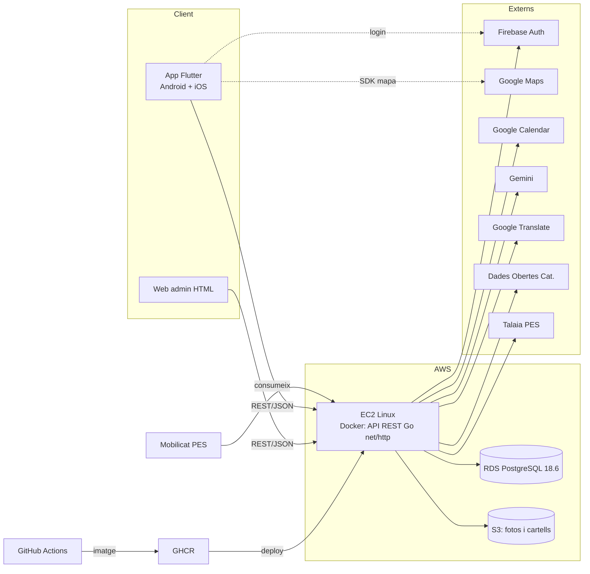

# 30 · Arquitectura

> **Quan llegir-ho:** quan un canvi travessa capes o repositoris, toca infraestructura, desplegament o serveis
> externs, o cal justificar una decisió. Per a l'estructura interna del frontend, llegeix
> `docs/architecture.md` (font de veritat del client; aquí no es repeteix).
> **Font:** `incepcio-2.pdf` §9 i `memoria.pdf` §3.4.

## Diagrama físic

`TODO(confirmar)`: el PDF diu que el servidor parla amb tots els serveis externs i que les claus només són al
backend. Però l'inici de sessió amb Firebase i el SDK de Google Maps solen executar-se al client amb claus
restringides. Cal decidir-ho en un ADR quan s'integrin.

## Regles d'arquitectura (vinculants)

1. **Punt d'entrada únic:** l'app i la web només parlen amb l'API REST. Flutter **mai** no accedeix a la BD.
2. **Lògica i permisos al servidor.** El client valida per usabilitat; el servidor valida sempre.
3. **Backend sense framework:** només `net/http` de la stdlib (vegeu ADR-0001). Dependències mínimes.
4. **Serveis externs darrere d'interfícies** (proves deterministes; vegeu skill `integracio-externa`).
5. **Fallada aïllada:** si cau Gemini, Translate o Calendar, el mapa, el llistat i l'agenda continuen funcionant.
6. **Secrets només al backend** (`.env` local, secrets de GitHub, variables injectades al contenidor a EC2).
7. **Migracions versionades** dins del backend, aplicades automàticament en cada versió.

## Capes

- **Frontend:** per funcionalitats amb MVVM (`models/`, `repositories/`, `data/`, `presentation/{screens,view_models,widgets}`).
  Detall a `docs/architecture.md`. Encara no hi ha gestor d'estat extern ni client HTTP.
- **Backend (`api-aprop`):** `cmd/app/main.go` → `internal/router` (`http.ServeMux`) → `handlers/<x>_handler`
  → `services/<x>_service` (interfície + implementació) → `repositories/<x>_repository` (interfície;
  actualment `memory_event_repository`) i `clients/<x>_client` (p. ex. `gencat_client`). Models a
  `internal/models/<x>_model`. Resposta comuna a `handlers/response`.

## Entorns i desplegament

- Dos entorns, local i producció, tots dos amb Docker. `.env` local ignorat i `.env.example` versionat.
- Release a `main` → GitHub Actions construeix la imatge → GHCR → desplegament a EC2. CI a cada PR
  (detall a `60-metodologia-i-qualitat.md`).
- Reinici automàtic del servidor en cas de caiguda (objectiu de disponibilitat: 99 %).

## Decisions

| ADR | Decisió |
|---|---|
| `decisions/ADR-0001-go-sense-framework.md` | Go 1.25 amb `net/http`, sense framework |
| `decisions/ADR-0002-flutter.md` | Flutter davant de React Native |
| `decisions/ADR-0003-firebase-auth.md` | Autenticació delegada a Firebase |

Altres eleccions documentades als PDFs, sense ADR propi: AWS (allotjament i persistència en una plataforma,
amb capa gratuïta), PostgreSQL (model molt relacional), S3 (fitxers multimèdia), GHCR (integrat amb GitHub)
i web admin en HTML simple (l'ús és només de moderació).
